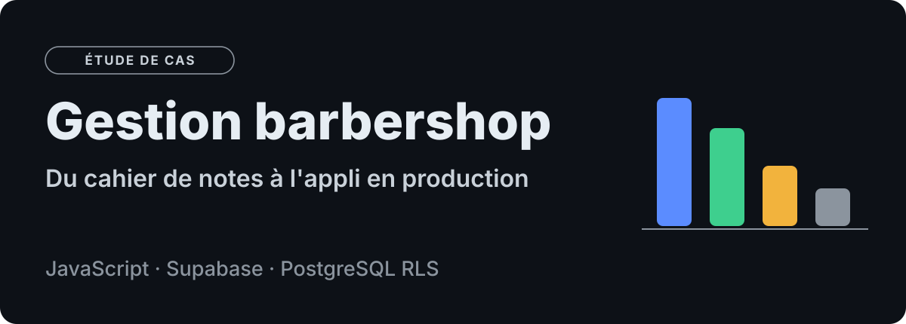
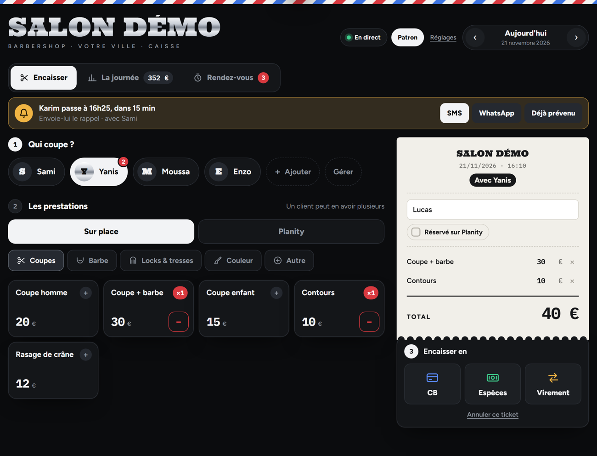
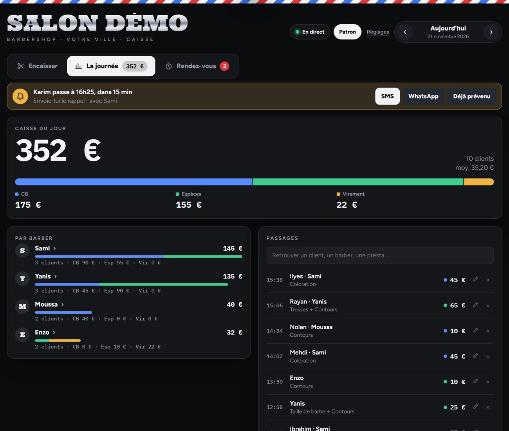
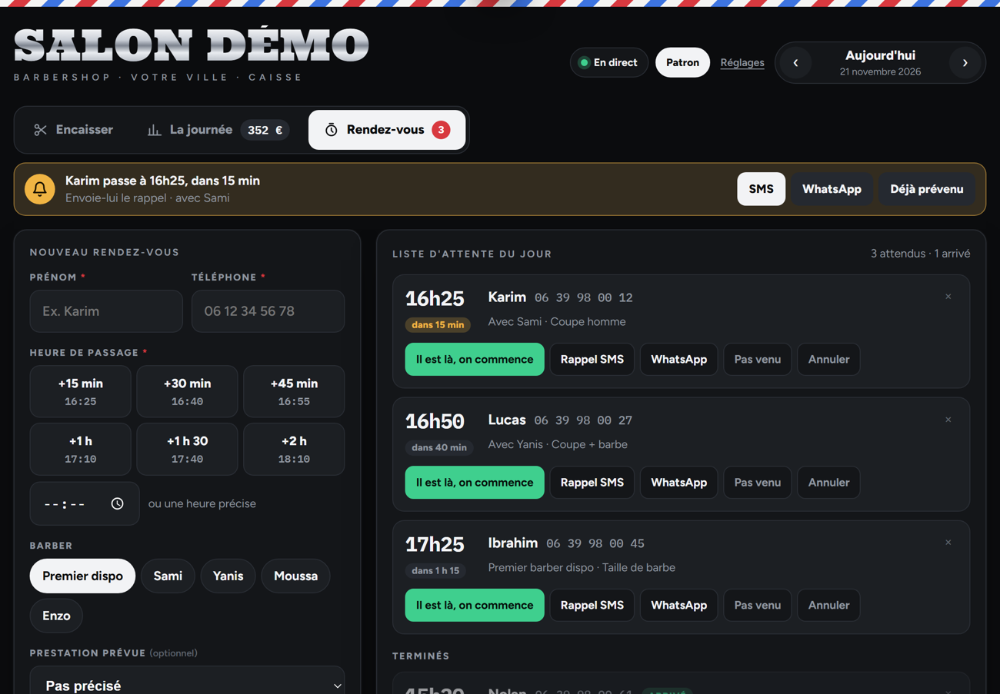
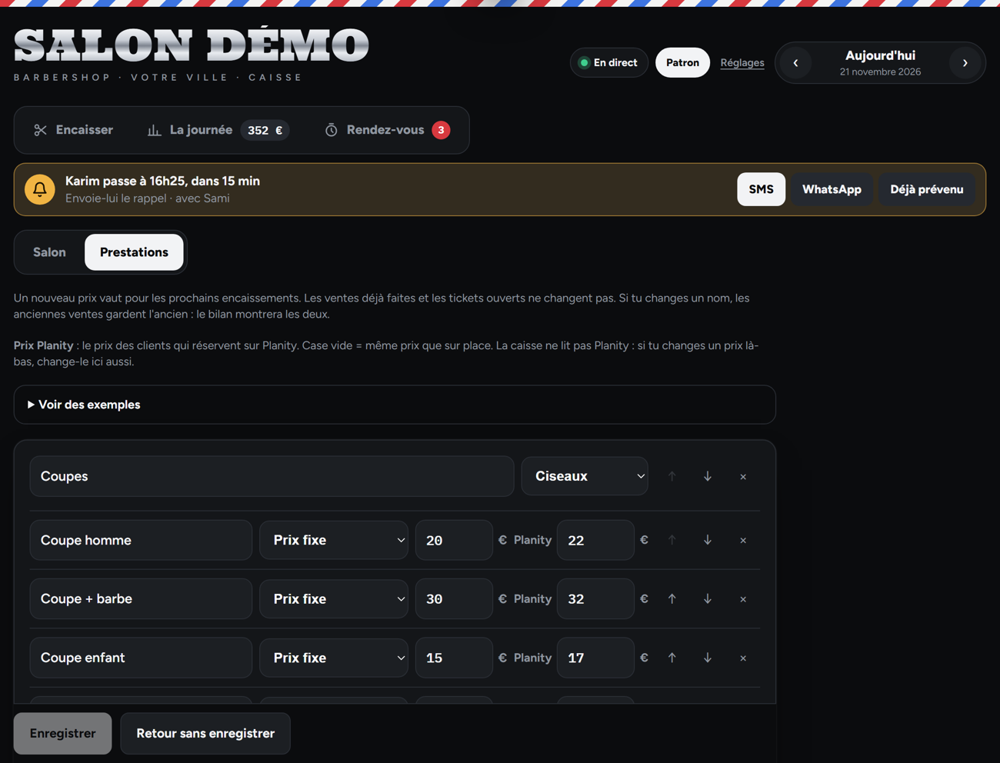
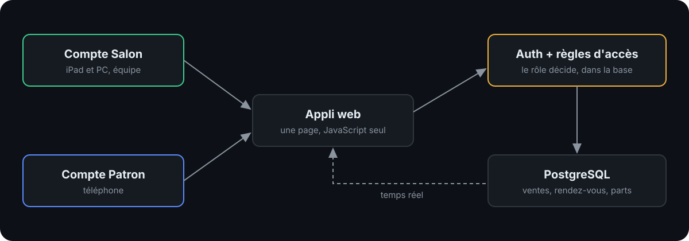

 

Appli web de gestion interne, en service dans un barbershop. 
Comment elle est née, comment elle a évolué, et **le pourquoi des choix**.

[Documentation](docs/README.md) · [Les versions](docs/07-versions.md) · [LinkedIn](https://www.linkedin.com/in/jobb-mam-iii/)

---

> Le salon est anonyme, les captures viennent d'une démo avec des données fictives. Le code de l'appli n'est pas publié ici : ce dépôt raconte le projet.

## Le besoin

Un ami a ouvert un barbershop. Il notait les prestations de chaque barber dans une application de notes et calculait les parts à la main en fin de mois. Je lui ai construit un outil pour l'iPad du salon et son téléphone. Il garde une vraie caisse à côté.

## L'appli

| Un ticket par barber | La journée, côté patron |
|---|---|
|  |  |
| **Les rendez-vous** | **Les réglages** |
|  |  |

## Comment elle a grandi

1. **Remplacer les notes** : un ticket par barber, la journée, un bilan par période.
2. **Les clients sans réservation** : une liste d'attente avec rappel par SMS ou WhatsApp.
3. **Deux rôles** : les gérants ne voulaient plus que l'équipe voie les chiffres. La règle est dans la base, pas seulement à l'écran.
4. **Ne plus rien effacer** : annuler ou corriger ajoute des lignes, l'original reste.
5. **Le patron autonome** : nom, logo, couleurs, prestations et prix se changent dans l'appli.
6. **Le compte du soir** : le patron choisit ce que l'équipe voit.
7. **Les parts des barbers** : le besoin de départ, ajouté une fois le reste solide.

Détail dans [les versions](docs/07-versions.md).

## Architecture

## Documentation

| Fiche | Sujet |
|---|---|
| [01 · Le besoin de départ](docs/01-besoin.md) | D'où vient le projet |
| [02 · Architecture](docs/02-architecture.md) | Choix techniques et contreparties |
| [03 · Rôles et accès](docs/03-roles-et-acces.md) | Ce que la base refuse |
| [04 · Corriger sans effacer](docs/04-corriger-sans-effacer.md) | Annuler avec des lignes plus et moins |
| [05 · Parts des barbers](docs/05-parts-des-barbers.md) | Pourcentages, dates et centimes |
| [06 · Mettre à jour un salon en service](docs/06-mise-en-production.md) | Changer une base en service sans rien perdre |
| [07 · Les versions](docs/07-versions.md) | Ce qui a changé, et pourquoi |

## Ce que j'en retiens

- Un bouton caché n'est pas une protection : la base doit refuser.
- Une sauvegarde compte seulement après une restauration réussie.
- Le patron change d'avis en utilisant l'outil. Le rendre réglable évite de le réécrire.

## Limites

- Pas de vente hors ligne.
- Aucune certification de logiciel de caisse : c'est un outil de gestion interne.
- Les parts viennent d'être mises en ligne, le retour du patron est attendu.
