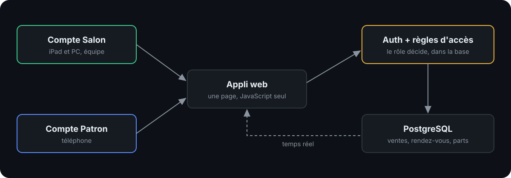

# 02 · Architecture

[← Accueil du dépôt](../README.md) · [Sommaire](README.md) · [03 · Rôles et accès →](03-roles-et-acces.md)

## Les choix

| Choix | Pourquoi | Contrepartie |
|---|---|---|
| Une seule page, JavaScript sans framework | Rien à compiler, mise en ligne en un fichier | Le fichier grossit : environ 1 500 lignes au départ, plus de 2 000 ensuite |
| Supabase (PostgreSQL hébergé) | Comptes, base et temps réel sans serveur à administrer | La protection dépend entièrement des règles de la base |
| Temps réel | L'iPad et le téléphone du patron affichent la même chose | Il faut recharger la journée à chaque événement, sans rafale |
| Pas de vente hors ligne | Évite les doublons quand le réseau revient | Sans réseau, le ticket reste ouvert jusqu'au retour |

## Mise à jour automatique

Chaque appareil relit la page de temps en temps et compare le numéro de version. Il ne se recharge que si aucun ticket ni formulaire n'est en cours : un ticket ouvert n'existe que dans la mémoire de l'appareil.
