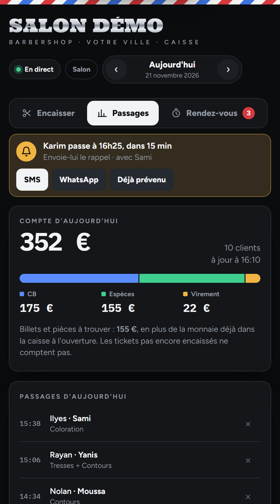

# 04 · Corriger sans effacer

[← Accueil du dépôt](../README.md) · [Sommaire](README.md) · [05 · Parts des barbers →](05-parts-des-barbers.md)

## Le problème

Le crayon et la croix modifiaient la vente d'origine. Après une erreur, plus moyen de savoir ce qui avait été saisi.

## La solution : plus et moins

- **Annuler** ajoute une ligne « moins ».
- **Corriger** ajoute une ligne « moins », puis une ligne « plus » avec les bonnes valeurs.
- **Remettre** une vente annulée par erreur ajoute une ligne « plus ».

Aucun compte de l'appli ne peut modifier ni supprimer une vente : la base refuse. L'original reste visible. Le patron choisit jusqu'où l'équipe peut annuler (jamais, le jour même, la veille).

Cette méthode ne fait pas de l'outil un logiciel de caisse certifié, et ce n'est pas son but.
